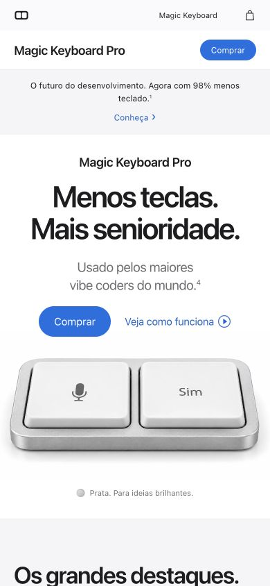

# Validação

## Revisão visual e funcional

A página foi revisada no navegador integrado em áreas de 1440×900, 1280×720, 390×844 e 360×640 pixels. Nos estados conferidos, não houve rolagem horizontal, imagens quebradas, títulos cortados ou erros de console.

Foram conferidos:

- Galeria com setas e teclado; abertura e fechamento dos detalhes.
- Três fases do scroll e retorno às fases anteriores.
- Início da demo pelo microfone e pela barra do chat, três aprovações, conclusão e reinício.
- Desabilitação dos controles durante a demo e retorno de foco no reinício.
- Troca de acabamento e compra conceitual nas duas cores.
- Escape e retorno de foco nos diálogos.
- Quebras de linha da copy de vibe coding e dos pedidos de permissão em telas estreitas.

As alternativas de movimento reduzido foram revisadas no código. Não foi feito teste em um iPhone físico.

Depois da organização com Vite, o build compilado foi conferido novamente em 390 e 360 pixels: render do hero, demo completa e reinício, troca para preto espacial, compra conceitual, Escape e retorno de foco. Sem rolagem horizontal ou erros de console nos estados verificados.

## Verificação automática

`npm run check` valida formatação, sintaxe JavaScript, IDs únicos, âncoras, símbolos SVG, arquivos referenciados e a presença dos cinco originais e WebPs. `npm run build` também verifica os caminhos dos arquivos gerados em `dist/`.

A CI executa instalação pelo lockfile, verificação e build. Ela não substitui a revisão visual no navegador.
